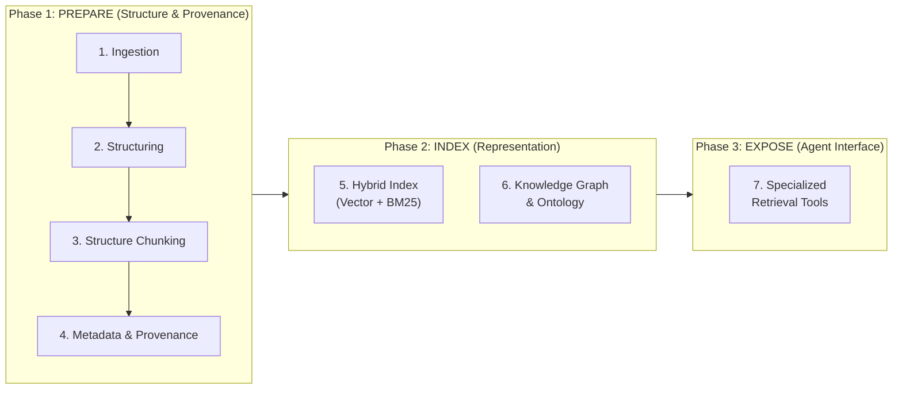
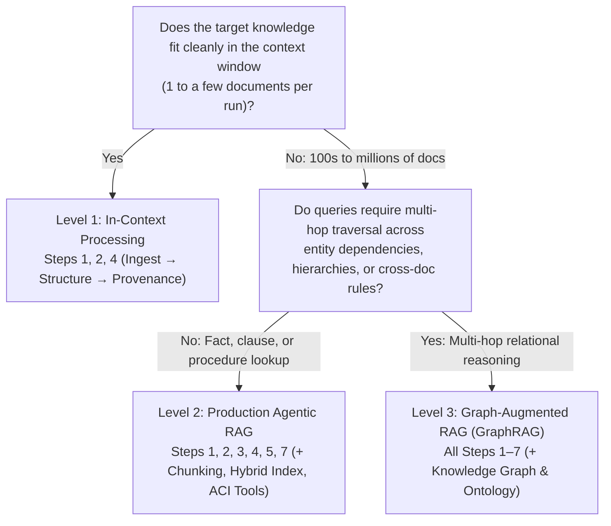

# Knowledge Engineering for AI Agents study guide

> **Author:** Michaël Bettan  
> **Version:** 1.0

---

## Overview

**Definition:** **Knowledge Engineering** for AI agents is the discipline of transforming raw, unstructured enterprise data into structured, traceable, and mistake-proof retrieval systems and tools (**Agent-Computer Interfaces**) so an LLM can reason over verified ground truth.

**Core thesis:** an agent is only as reliable as the ground truth returned by its tools. Even the most sophisticated reasoning loop (ReAct, Evaluator-Optimizer, or Orchestrator-Workers) will confidently hallucinate if its underlying knowledge layer drops tables, bisects clauses, ignores document versions, or misses multi-hop entity relationships.

**Knowledge engineering solves for:** the five structural gaps between a prototype "chat with your PDF" demo and a production enterprise agent:

1. **Silent parsing corruption:** naive text extractors (`pypdf`) strip table grids, scramble multi-column layouts, and return empty strings on scanned documents.
2. **Severed logical context:** fixed-token chunking slices legal clauses away from their exceptions and separates table rows from column headers.
3. **Permission & version blindness:** pure vector similarity ignores whether a policy is superseded, expired, or restricted to another tenant's ACL.
4. **Lexical & relational blindness:** dense embeddings miss exact SKUs, clause IDs, and error codes, and flat chunks cannot traverse multi-hop dependencies (`Entity A → Entity B → Entity C`).
5. **Ambiguous tool interfaces:** handing an agent a single generic `search_all(query: str)` tool forces the model to guess query syntax and filters, degrading retrieval precision.

> **Mental model:**  
> - **Agent Design Patterns (`ADP`)** build the *nervous system* (how the agent thinks, loops, and asks for human approval).  
> - **Knowledge Engineering** builds the *library and catalog* (how raw files become clean books, indexed by topic, keyword, and citation network, with a librarian desk of specialized lookup tools).

> **Scope vs. the RAG guide:** the RAG guide covers the retrieve-then-generate pipeline end to end (embeddings, retrieval, reranking, generation, evaluation). This guide focuses on the **data and interface layer underneath it**: turning raw sources into clean, traceable, permission-aware knowledge and exposing it through safe agent tools.

---

## 1. Naive RAG vs. Agentic Knowledge Engineering

| Dimension        | Naive RAG (Prototype)                      | Knowledge Engineering (Production)                                   | Memory hook                                           |
| :--------------- | :----------------------------------------- | :------------------------------------------------------------------- | :---------------------------------------------------- |
| **Parsing**      | Raw text stream (drops tables & layout)    | Layout-aware vision/OCR (`Docling`, Document AI; preserves tables)   | _"Read the page layout, not just the raw bytes"_      |
| **Chunking**     | Fixed size (e.g., every 500 tokens)        | Structure-aware (split by section, clause, or intact table)          | _"Cut at chapter seams, never mid-sentence"_          |
| **Context**      | Raw text only                              | Rich metadata & provenance (`doc_id`, `version`, `date`, `owner`)    | _"Every quote carries its birth certificate"_         |
| **Search**       | Vector similarity only                     | Hybrid (Vector + BM25) + Metadata pre-filters + Knowledge Graph      | _"Meaning + exact IDs + relationship web"_            |
| **Agent Access** | Passive prompt stuffing (1 generic search) | Active, strongly-typed **Retrieval Tools** (ACI / MCP)               | _"Specialized scalpel tools, not one blunt shovel"_   |

> [!WARNING]
> **Exam & production trap:** Upgrading the foundation model (e.g., from a fast tier to a frontier tier) **cannot** fix an upstream knowledge engineering failure. If a parser drops a table column or a 500-token split cuts out a `"provided, however, that..."` exception clause, a smarter model only hallucinates more persuasively.

---

## 2. The 3-Phase Framework (7 Steps to Memorize)

Instead of memorizing 7 isolated items, group them into **3 logical phases**: **Prepare $\rightarrow$ Index $\rightarrow$ Expose**.

```
┌──────────────────────────────────────────────────────────────────────────────────────────┐
│  PHASE 1: PREPARE (Structure & Provenance)                                               │
│  ┌──────────────┐    ┌──────────────────┐    ┌──────────────────┐    ┌────────────────┐  │
│  │ 1. Ingestion ├───►│ 2. Structuring   ├───►│ 3. Structure     ├───►│ 4. Metadata &  │  │
│  │ (Layout/OCR) │    │ (MD/JSON/Tables) │    │    Chunking      │    │    Provenance  │  │
│  └──────────────┘    └──────────────────┘    └──────────────────┘    └───────┬────────┘  │
└──────────────────────────────────────────────────────────────────────────────┼───────────┘
                                                                               │
┌──────────────────────────────────────────────────────────────────────────────▼───────────┐
│  PHASE 2: INDEX (Representation)                                                         │
│  ┌───────────────────────────────────────┐  ┌─────────────────────────────────────────┐  │
│  │ 5. Embeddings & Hybrid Index          │  │ 6. Knowledge Graph & Ontology           │  │
│  │    Dense Vectors + Sparse BM25 + RRF  │  │    Entity A ──[Relation]──► Entity B    │  │
│  └───────────────────┬───────────────────┘  └────────────────────┬────────────────────┘  │
└──────────────────────┼───────────────────────────────────────────┼───────────────────────┘
                       └─────────────────────┬─────────────────────┘
                                             ▼
┌──────────────────────────────────────────────────────────────────────────────────────────┐
│  PHASE 3: EXPOSE (Agent-Computer Interface / MCP)                                        │
│  ┌────────────────────────────────────────────────────────────────────────────────────┐  │
│  │ 7. Specialized Retrieval Tools                                                     │  │
│  │    get_record_by_id() · search_active_policies() · trace_entity_dependencies()     │  │
│  └────────────────────────────────────────────────────────────────────────────────────┘  │
└──────────────────────────────────────────────────────────────────────────────────────────┘
```



---

### Phase 1: PREPARE — Make Data Clean, Complete & Traceable

#### Step 1: Document Ingestion
* **What it is:** Extracting content from raw enterprise formats (PDFs, DOCX, HTML, scans, emails, spreadsheets) using layout-aware and OCR-capable parsers rather than raw character-stream readers.
* **Why it matters:** Standard text extractors (`pypdf`) fail silently on scanned images, multi-column layouts, and complex tables—triggering *silent data corruption* (*garbage in, confident hallucination out*).
* **Production pattern (Tiered Extraction & Epistemic Gating):**
  1. **Tier 1 (Fast stream check, `~0.05s`):** Use `pypdf`/`pdfplumber` on clean, single-column digital PDFs.
  2. **Tier 2 (Layout/Vision OCR fallback, `2–10s`):** Route low-density pages, tables, or scans to **`Docling`** (local layout model + `TableFormer` + OCR) or a managed cloud parser (e.g., **Google Document AI**).
  3. **Composite Extraction Quality Gate:** Score extraction integrity across four real signals (native OCR confidence, dictionary word ratio, character entropy, structural completeness) and hard-stop below a threshold (e.g., `< 0.70`) before indexing or calling an LLM.

#### Step 2: Normalization & Structuring
* **What it is:** Converting raw extracted text into a clean, canonical hierarchy—Markdown with explicit `#` / `##` / `###` headings, serialized Markdown/HTML tables, structured JSON records, and normalized entities (dates in ISO-8601 `YYYY-MM-DD`, standardized currency/units).
* **Why it matters:** LLMs and downstream chunkers rely on structural markers to understand scope (which sub-clause belongs to which parent article, or which cell belongs to which column header).
* **Key outputs:** A typed document object (such as `DoclingDocument`) preserving reading order, section hierarchy, bounding boxes, and table grids.

#### Step 3: Structure-Aware Chunking
* **What it is:** Splitting documents along **logical and semantic boundaries** (sections, subsections, complete tables, atomic clauses) rather than arbitrary fixed token counts (e.g., slicing every 500 tokens).
* **Why it matters:** Fixed-token chunking cuts rules away from their exceptions (*"The vendor is liable for all damages..."* in Chunk 1; *"...except indirect or consequential damages"* in Chunk 2) and separates table rows from their column headers, causing partial-context hallucinations.
* **Production techniques:**
  * **Layout/Header-aware chunking (`HybridChunker`):** Starts from the document hierarchy (section headers), then splits oversized chunks and merges undersized siblings to respect the embedding tokenizer's limit.
  * **Intact table preservation:** Serializes tables whole (or attaches column headers to every row group) so row-column relationships are never severed.
  * **Hierarchical (parent-child) chunking:** Embeds small child chunks (128–256 tokens) for high-precision vector matching, but follows metadata pointers to return the larger parent section (1,024–2,048 tokens) to the LLM.
  * **Contextual retrieval (Anthropic pattern):** Prepends a short, chunk-specific context to every chunk *before* computing its embedding and BM25 index. In Anthropic's version, an LLM reads the whole document plus the chunk and writes ~50–100 tokens that situate the chunk. A cheap fallback is a document/section breadcrumb (`[Doc: MSA_2026 | Section 8.2: Limitation of Liability]`).

#### Step 4: Metadata & Provenance
* **What it is:** Attaching a mandatory, structured metadata envelope to every chunk:
  * **Provenance & location:** `source_uri`, `doc_id`, `section_path`, `page_number`, `bounding_box`.
  * **Lifecycle & governance:** `created_date`, `effective_date`, `expiration_date`, `version`, `status` (`"active"` vs. `"superseded"`), `owner`, `access_acl` / `tenant_id`.
* **Why it matters (solves two critical problems):**
  1. **Pre-search deterministic filtering:** Prevents retrieving expired policies, draft documents, or unauthorized records from another tenant *before* vector scoring runs.
  2. **Post-generation auditability:** Enables exact inline citations (`(Source: Section 4.2, Page 14)`) so humans or adversarial auditor nodes can deterministically verify every factual claim.

---

### Phase 2: INDEX — Make Knowledge Findable by Meaning, Keyword & Relationship

#### Step 5: Embeddings & Hybrid Indexes
* **What it is:** Combining two complementary retrieval representations over the same structured chunks:
  * **Dense Vector Search (Embeddings):** Maps text into continuous geometric space ($768\text{–}3072$ dims, served via ANN indexes such as HNSW or ScaNN) to capture semantic meaning, intent, and synonyms (*"termination for cause"* $\leftrightarrow$ *"ending the agreement due to breach"*).
  * **Sparse Lexical Search (BM25 / Keyword):** Scores exact token matches using term-frequency saturation, inverse document frequency (IDF), and document-length normalization to capture exact strings (**SKUs, part numbers, error codes, clause numbers like `Section 12.4(b)`, acronyms, and proper nouns**).
* **Why it matters:** Dense vectors blur exact alphanumeric identifiers; keyword search misses paraphrased concepts. Production systems run **both in parallel**, merge their ranked lists using **Reciprocal Rank Fusion (RRF, $k=60$)**:
  $$RRF(d) = \sum_{m \in \{\text{Dense}, \text{BM25}\}} \frac{1}{60 + \text{rank}_m(d)}$$
  and pass the top-$K$ ($K \approx 50$) candidates through a **Cross-Encoder Reranker** (e.g., Cohere Rerank, BGE-Reranker, or a managed cloud ranking API) to select the top-$N$ ($N \approx 5$) highest-precision passages.

#### Step 6: Knowledge Graph & Ontology
* **What it is:** Modeling domain knowledge as explicit **nodes (entities)** and **directed edges (relationships)** (`Entity A ──[Relationship]──► Entity B`) governed by a formal schema (**ontology**).
* **Why it matters:** Vector and keyword indexes find *passages with similar text*, but fail when answering a question requires **multi-hop relational reasoning**, dependency tracing, or global aggregation across isolated documents.

```
  [Service: Checkout-API] ──(depends_on)──► [DB: Payments-Cluster-02]
                                                       │
                                                 (hosted_in)
                                                       ▼
  [Policy: PCI-DSS-v4] ◄──(governed_by)─── [Region: eu-central-1]
```

* **Ontology vs. Knowledge Graph:**
  * **Ontology (the schema / TBox):** Defines the allowed entity classes (`Contract`, `Party`, `Clause`, `Jurisdiction`), relationship predicates (`governed_by`, `supersedes`, `indemnifies`), and constraints (authored in RDFS, OWL, or Pydantic/TypeDB schemas).
  * **Knowledge Graph (the instances / ABox):** The populated network of real-world entities and edges extracted from enterprise documents and databases (stored in Neo4j, Spanner Graph, Neptune, or FalkorDB and queried via **Cypher**, **GQL**, or **SPARQL**).
* **Hybrid GraphRAG pattern:** Use vector/hybrid search to locate the initial entry entity or passage, traverse $1\text{–}3$ hops along explicit ontology edges to gather connected rules/dependencies, and serialize both the subgraph path and source text chunks into the LLM prompt.

---

### Phase 3: EXPOSE — Turn Indexes into Agent Tools

#### Step 7: Retrieval Tools (The Agent-Computer Interface)
* **What it is:** Wrapping your hybrid indexes, metadata filters, and knowledge graphs into narrow, strongly-typed, mistake-proof functions (exposed via **MCP — Model Context Protocol**) that the agent invokes intentionally.
* **Why it matters:** Giving an agent one vague `search_all(query: str)` tool is an anti-pattern—the model must guess how to phrase queries, cannot enforce deterministic metadata constraints, and floods its own context window with noisy chunks.
* **ACI & Poka-Yoke design rules for retrieval tools:**
  1. **Decompose by domain intent:** Replace `search_all(query: str)` with purpose-built tools:
     * `get_policy_by_id(policy_id: str)` $\rightarrow$ exact key/BM25 lookup.
     * `search_active_clauses(category: Literal["indemnity", "termination", "ip"], jurisdiction: str, effective_after: str)` $\rightarrow$ hybrid search with mandatory pre-filters.
     * `trace_system_dependencies(service_name: str, max_hops: int = 2)` $\rightarrow$ deterministic graph traversal.
  2. **Poka-Yoke the arguments:** Use `Literal` enums, ISO date validators, and bounded `top_k: int = Field(default=5, le=10)` so the model cannot request 500 chunks or pass invalid category names.
  3. **Return structured provenance:** Every tool response should return structured objects containing `chunk_text`, `doc_id`, `section_path`, `page_number`, and `effective_date` so downstream generator and auditor agents can verify citations deterministically.

#### Structured data tools: parameterized queries vs. NL2SQL
Questions such as "total refunds by region last quarter" need exact filters, joins and aggregates, which embeddings cannot compute. Expose tables through a query tool instead of indexing rows as text, and choose the most constrained tool shape that still answers the questions users actually ask.

| Tool shape | Who writes the SQL | Use when | Main risk | Core controls |
| :--- | :--- | :--- | :--- | :--- |
| **Parameterized query tool** (`get_refunds_by_region(region, quarter)`) | An engineer, ahead of time; the model only fills typed arguments | Questions are known and recurring; customer-facing paths; anything that writes | Cannot answer questions outside the tool catalog | Enum and typed arguments, bound parameters, never string concatenation |
| **NL2SQL over a curated layer** (approved views plus metric definitions) | The model, against a small set of documented views | Analysts ask varied questions over a well-defined domain | A wrong join or metric definition that still returns a plausible number | Approved views only, a metric glossary in context, verified example queries |
| **Open NL2SQL over the schema** (`execute_sql`) | The model, against any table it can discover | Exploration by trusted internal users in a sandbox | Expensive scans, data exposure, injected text steering the query | Everything below, plus human review before results are shared |

* **Read-only identity:** the database account can only `SELECT` from approved views. Permissions enforce safety; a prompt instruction does not.
* **Validate before you execute:** parse the statement, reject anything other than a single `SELECT`, dry-run it to estimate bytes scanned, and enforce a cost ceiling and a row `LIMIT`.
* **Row-level security follows the user:** propagate the end user's identity so the database filters rows, rather than trusting the agent to add the right `WHERE` clause.
* **Return the query with the answer:** include the SQL and the row count so the user or an auditor agent can check how the number was produced.
* **Evaluate on results, not text:** compare the result set of each generated query with a reference query on a golden question set; two different SQL strings can both be correct.
* **On Google Cloud:** [MCP Toolbox for Databases](https://mcp-toolbox.dev/) supports both ends: `bigquery-sql` and `postgres-sql` tools run a predefined statement with bound parameters, while `bigquery-execute-sql` accepts model-written SQL and offers a dry run. BigQuery [conversational analytics](https://docs.cloud.google.com/bigquery/docs/conversational-analytics) data agents sit in the middle, grounded by authored context and verified queries.

---

## 3. Progressive Scaling Ladder: When Do You Need Which Steps?

Apply **progressive complexity** (Anthropic's Rule 0)—only add indexing and graph layers when your corpus scale or query topology proves simpler levels fall short:



| Level | Data & Task Profile | Steps Needed | What You Skip & Why |
| :--- | :--- | :--- | :--- |
| **Level 1: In-Context Processing** | Analyzing **1 to a few documents** at a time (e.g., reviewing a single uploaded contract or invoice that fits in context). | **Steps 1, 2, 4**<br>*(Ingest $\rightarrow$ Structure $\rightarrow$ Provenance)* | **Skip Steps 3, 5, 6, 7.** Do not chunk or embed a 10-page document just to retrieve 5 chunks from it; parse it cleanly with `Docling`, attach page/section provenance, and pass the structured Markdown directly. |
| **Level 2: Production Agentic RAG** | Searching across **hundreds to millions of documents** for facts, clauses, policies, or support procedures. | **Steps 1, 2, 3, 4, 5, 7**<br>*(Add Structure Chunking + Hybrid Index + Retrieval Tools)* | **Skip Step 6 (Knowledge Graph)** if queries can be answered by retrieving self-contained sections via semantic + keyword search and metadata filtering. |
| **Level 3: Graph-Augmented RAG (GraphRAG)** | Complex domains where **relationships, dependencies, hierarchies, or cross-document rules** drive the answer (e.g., supply-chain impact, microservices root-cause, regulatory cross-references). | **All Steps (1–7)**<br>*(Add Knowledge Graph / Ontology + Graph Lookup Tools)* | **Nothing skipped**—combines structure-aware hybrid search with explicit graph traversal exposed as specialized agent tools. |

---

## 4. Diagnostic Cheat Sheet: "Symptom $\rightarrow$ Missing Step"

Use this table in architecture reviews, interviews, or debugging sessions to pinpoint why an agent is failing:

| Agent Failure Symptom | Which Step Is Broken? | Root Cause | The Engineering Fix |
| :--- | :--- | :--- | :--- |
| Agent misses numbers inside tables or hallucinates on scanned PDFs | **01. Ingestion** / **02. Structuring** | Basic stream parser (`pypdf`) dropped table structure or returned empty text on scans | Switch to tiered layout-aware/OCR parsing (`Docling` locally or Document AI) + Pre-LLM quality gate |
| Agent retrieves a general rule but misses the exception right below it | **03. Structure-Aware Chunking** | Fixed 500-token splitter severed the rule from its sub-clause or table header | Split along Markdown headers/clauses (`HybridChunker`), keep tables intact, or use parent-child chunks |
| Agent cites an outdated 2022 policy or leaks another customer's record | **04. Metadata & Provenance** | Chunks lack lifecycle/ACL tags, or retrieval runs without pre-filtering | Attach `version`, `status="active"`, `effective_date`, and `tenant_id`; enforce mandatory pre-filters |
| Agent finds general topics well, but fails on exact SKUs, clause IDs, or error codes | **05. Embeddings & Hybrid Index** | Pure dense vector embeddings smooth over exact alphanumeric strings | Upgrade to **Hybrid Search (Dense Vector + Sparse BM25)** fused via **RRF ($k=60$)** + Cross-Encoder reranking |
| Agent fails on multi-hop questions (*"If Vendor X defaults, which SLA in Contract Y is triggered via Subsidiary Z?"*) | **06. Knowledge Graph & Ontology** | Flat chunks have zero lexical/vector overlap across the intermediate hops | Model entities and relationships in a **Knowledge Graph** governed by an ontology; expose traversal queries |
| Agent writes overly broad, unparseable, or hallucinated search queries | **07. Retrieval Tools (ACI)** | Single generic `search(query)` tool gives the LLM too much freedom and zero guardrails | Expose narrow, typed **MCP tools** with `Literal` enums, date filters, and junior-dev docstrings (Poka-Yoke) |

---

## 5. Operating the Knowledge Layer: Multimodal, Access, Freshness, Memory & Evaluation

The 7 steps build the knowledge layer once. A production agent also needs it to handle non-text sources, respect permissions, stay current, stay separate from agent memory, and be measured. For pipeline-level depth, see the RAG guide (indexing, security, freshness, evaluation); this section gives the knowledge-engineering decision rules.

### 5.1 Multimodal Sources (Audio, Video, Images)

| Source | Prepare it as | Provenance to keep |
| :--- | :--- | :--- |
| **Audio** (calls, meetings, voicemail) | Speech-to-text transcript with speaker labels (diarization) and timestamps; chunk by speaker turn or topic | `start_time`, `end_time`, `speaker`, `recording_id` |
| **Video** (training, demos, recorded incidents) | Transcript + scene/shot segments + keyframe descriptions, or one multimodal embedding per segment | Timestamp range, keyframe URI |
| **Images, diagrams, scanned forms** | OCR for text; a vision model's caption/description for figures; or a multimodal embedding model that maps images and text into the same vector space | `page_number`, `bounding_box`, `image_uri` |

> **Rule:** turn every media file into **time- or region-addressable units** so a citation points to *"minute 12:40"* or *"Figure 3, page 7"*, not just *"the video"*.

### 5.2 Identity-Aware Access & Sensitive Data

* **Filter by the end user's identity, in code.** Enforce ACLs inside the retrieval tool as a mandatory filter built from the *end user's* verified identity (propagated to the tool). Do not query with the agent's broad service credential, and never rely on a prompt such as *"ignore documents the user cannot see"*.
* **Sync permissions with content.** Ingest ACLs from the source system alongside the text. A permission change in the source must re-propagate to the index, just like a content change.
* **Redact before you index.** Remove or tokenize PII and secrets that retrieval does not need *before* embedding. Once sensitive text is in chunks and vectors, the only fix is to delete and re-index it.

> **Trap:** one shared index + a superuser credential + a prompt instruction to "respect permissions" = a data leak waiting to happen.

### 5.3 Freshness & Index Lifecycle

* **Incremental ingestion:** detect changes (content hash, modified timestamp, or change events) and re-parse/re-embed only the changed documents.
* **Deletes and supersession:** propagate deletions (remove or tombstone chunks) and flip old versions to `status="superseded"`, so two versions are never both "active".
* **Embedding model change ⇒ full re-embed:** vectors from different embedding models (or model versions) are not comparable, so never mix them in one index. Record `embedding_model` and `ingested_at` in metadata.
* **Monitor staleness:** track the lag between a source change and the index update.

### 5.4 Knowledge Base vs. Agent Memory

| Dimension | Knowledge base | Agent memory |
| :--- | :--- | :--- |
| **Source** | Curated enterprise documents and systems of record | The agent's own interactions (sessions) |
| **Scope** | Shared across users, filtered by ACL | Per user or per session |
| **Authority** | Authoritative, versioned ground truth | User-specific preferences and facts; can be wrong or stale |
| **Write path** | Ingestion pipeline (Steps 1–6) with owners and review | Agent extracts and consolidates facts during or after a session |
| **Lifecycle** | Versions, effective dates, supersession | TTL, consolidation, user deletion requests |

> **Rule:** do not write unverified conversation facts into the shared knowledge base, and do not store company policy in a user's memory. See the 4-tier memory model in the Agentic Design Patterns guide.

### 5.5 Evaluating the Knowledge Layer (Golden Dataset)

* **Build a golden set:** realistic queries (including exact-ID lookups, multi-hop questions, permission edge cases, and questions with **no** answer in the corpus), each mapped to the expected `doc_id`/chunk IDs and a reference answer.
* **Measure retrieval separately from generation:**
  * **Retrieval:** recall@k (did the right chunk reach the top-k?), precision@k, and rank-aware metrics such as MRR or nDCG (was it ranked high?).
  * **Generation:** groundedness/faithfulness (every claim supported by retrieved text), citation accuracy, answer correctness, and a correct "not found" when the corpus has no answer.
* **Read the result:** low recall@k points to Steps 1–5 (parsing, chunking, metadata, index). High recall but wrong answers point to generation (prompting, context overload). Permission violations point to Step 4 and §5.2.
* **Re-run on every change** to the parser, chunker, embedding model, reranker, or tools.

---

## 6. Exam Quick-Review

| Comparison | Key distinction |
| :--- | :--- |
| **Naive RAG vs. Knowledge Engineering** | Naive RAG = raw stream $\rightarrow$ fixed 500-token chunks $\rightarrow$ vector-only $\rightarrow$ prompt stuffing; Knowledge Engineering = layout parsing $\rightarrow$ structure chunking $\rightarrow$ provenance $\rightarrow$ hybrid + graph $\rightarrow$ typed ACI tools. |
| **Phase 1 (Prepare) vs. Phase 2 (Index) vs. Phase 3 (Expose)** | **Prepare** (Steps 1–4) makes data clean & traceable; **Index** (Steps 5–6) makes data findable by meaning, keyword & relationship; **Expose** (Step 7) turns indexes into mistake-proof agent tools. |
| **Fixed-token vs. Structure-aware chunking** | Fixed-token cuts every $N$ tokens (severing rules from exceptions and tables from headers); structure-aware splits on logical boundaries (headings, clauses, intact tables). |
| **Metadata pre-filtering vs. Post-generation citation** | Both rely on **Step 04 (Metadata & Provenance)**: pre-filtering enforces ACLs, recency, and active status *before* search; provenance tags enable deterministic citation verification *after* generation. |
| **Dense Vector vs. Sparse BM25 vs. Hybrid** | Dense = semantic meaning & synonyms; BM25 = exact SKUs, error codes, & clause numbers; Hybrid = both combined via Reciprocal Rank Fusion (RRF) + Cross-Encoder reranking. |
| **Hybrid RAG (Step 5) vs. GraphRAG (Step 6)** | Hybrid RAG retrieves relevant *text passages*; GraphRAG traverses explicit *entity-relationship edges* (`Entity A → Relation → Entity B`) for multi-hop reasoning and dependency analysis. |
| **Ontology vs. Knowledge Graph** | **Ontology** = the formal schema (allowed node types, edge predicates, constraints); **Knowledge Graph** = the populated data instances conforming to that ontology. |
| **Generic `search(query)` vs. Specialized Retrieval Tools (Step 7)** | Generic search forces the LLM to guess query syntax; specialized ACI/MCP tools constrain arguments with typed schemas (`Literal`, dates, IDs) to mistake-proof retrieval. |
| **Knowledge base vs. Agent memory** | Knowledge base = curated, shared (ACL-filtered), versioned ground truth; memory = per-user/session facts the agent extracts from interactions, with TTL and consolidation. |
| **Retrieval metrics vs. Generation metrics** | Retrieval = recall@k, precision@k, MRR/nDCG against golden chunk IDs; generation = groundedness, citation accuracy, answer correctness. Measure both separately. |

---

## 7. Self-Quiz (Cover the Answers)

1. **Q:** What are the 3 phases and 7 steps of Knowledge Engineering for AI Agents?  
   **A:** **Phase 1 — Prepare:** (1) Document Ingestion, (2) Normalization & Structuring, (3) Structure-Aware Chunking, (4) Metadata & Provenance. **Phase 2 — Index:** (5) Embeddings & Hybrid Indexes, (6) Knowledge Graph & Ontology. **Phase 3 — Expose:** (7) Specialized Retrieval Tools (ACI/MCP).
2. **Q:** Why is arbitrary 500-token chunking dangerous for agents?  
   **A:** It splits logical units (such as tables or legal clauses and their exceptions) in half, giving the agent incomplete ground truth and causing confident hallucinations.
3. **Q:** Why do production systems use Hybrid Search (Vector + BM25) instead of just Vector embeddings?  
   **A:** Dense embeddings capture semantic meaning and synonyms, while sparse BM25 captures exact keyword, SKU, acronym, and clause-ID matches that vector embeddings blur.
4. **Q:** When is a Knowledge Graph (Step 06) justified over standard Hybrid RAG (Step 05)?  
   **A:** When answers depend on multi-hop relationships, dependency chains, hierarchies, or cross-document relational rules between entities (`Entity A ──[relates_to]──► Entity B`).
5. **Q:** What two problems does Metadata & Provenance (Step 04) solve?  
   **A:** (1) **Pre-search filtering** (enforcing tenant ACLs, active versions, and effective dates before retrieval) and (2) **Post-generation auditability** (exact source citations verified by humans or auditor nodes).
6. **Q:** Why expose multiple specific retrieval tools in Step 07 instead of one generic `search(query)` tool?  
   **A:** Specific, strongly-typed tools (**Poka-Yoke ACI**) constrain the agent's search space via typed parameters and enums, preventing malformed queries and ensuring the right index/filter strategy is executed.
7. **Q:** Which steps do you need when analyzing a single 5-page contract that fits in the LLM context window (Level 1)?  
   **A:** Only **Steps 1, 2, and 4** (Ingestion $\rightarrow$ Normalization/Structuring $\rightarrow$ Metadata/Provenance). You skip chunking, vector/hybrid indexing, knowledge graphs, and search tools.
8. **Q:** You switch to a newer embedding model. Can you embed only new documents with it?  
   **A:** No. Vectors from different embedding models are not comparable, so re-embed the whole corpus (or build a new index and cut over). Record `embedding_model` in metadata.

---

## 8. Pocket Card (Quick Reference)

```
┌────────────────────────────────────────────────────────────────────┐
│  KNOWLEDGE ENGINEERING FOR AGENTS — 3 PHASES, 7 STEPS              │
├────────────────────────────────────────────────────────────────────┤
│  PHASE 1: PREPARE (Clean & Traceable)                              │
│    01. Ingestion       Layout + OCR parsing (tables, scans, PDFs)  │
│    02. Structuring     Raw text → Markdown sections / JSON / tables│
│    03. Chunking        Split by structure (headers/tables), not N  │
│    04. Provenance      Tag doc_id, date, version, section, ACL     │
│                                                                    │
│  PHASE 2: INDEX (Findable)                                         │
│    05. Hybrid Index    Dense Vectors (meaning) + BM25 (exact IDs)  │
│    06. Knowledge Graph Entity → Relation → Entity (multi-hop rules)│
│                                                                    │
│  PHASE 3: EXPOSE (Actionable ACI)                                  │
│    07. Retrieval Tools Domain-specific, typed MCP tools (Poka-Yoke)│
├────────────────────────────────────────────────────────────────────┤
│  SCALING LADDER                                                    │
│    • Level 1 (In-Context, 1–few docs): Steps 1, 2, 4               │
│    • Level 2 (Production Agentic RAG): Steps 1, 2, 3, 4, 5, 7      │
│    • Level 3 (GraphRAG, multi-hop):    All Steps 1–7               │
└────────────────────────────────────────────────────────────────────┘
```

---

## Glossary

* **Knowledge Engineering:** the discipline of turning raw, unstructured data into structured, traceable, and mistake-proof retrieval systems and tools for AI agents.
* **Layout-aware ingestion (Step 01):** extracting document content using computer-vision layout detection and OCR (`Docling`, Google Document AI, `LlamaParse`) to preserve reading order and tables.
* **Normalization & structuring (Step 02):** transforming raw extracted text into hierarchical Markdown headings (`#`, `##`), structured JSON, intact tables, and canonical entity formats.
* **Structure-aware chunking (Step 03):** splitting documents along semantic and structural boundaries (sections, clauses, intact tables, parent-child hierarchies) rather than fixed token counts.
* **Metadata & provenance (Step 04):** structured attributes (`doc_id`, `section_path`, `page_number`, `version`, `effective_date`, `access_acl`) attached to every chunk for pre-search filtering and post-generation citation verification.
* **Hybrid index (Step 05):** retrieval index combining dense semantic embeddings (vector search) and sparse lexical matching (**BM25**), merged via **Reciprocal Rank Fusion (RRF)** and refined with a **Cross-Encoder reranker**.
* **Knowledge Graph (Step 06):** a network of typed nodes (entities) and directed edges (relationships) representing domain facts and dependencies for multi-hop reasoning.
* **Ontology:** the formal schema governing a knowledge graph, defining valid entity classes, relationship predicates, hierarchies, and constraints (e.g., RDFS, OWL).
* **Retrieval tools / ACI (Step 07):** narrow, strongly-typed, well-documented functions (often exposed via **MCP**) that give an agent structured, mistake-proof (**Poka-Yoke**) access to hybrid indexes and knowledge graphs.
* **Identity-aware retrieval:** enforcing document ACLs inside the retrieval tool using the end user's propagated identity, rather than the agent's broad credential or a prompt instruction.
* **Golden dataset:** a curated set of queries mapped to expected source chunks and reference answers, used to measure retrieval (recall@k, MRR/nDCG) and generation (groundedness, citation accuracy) after every change.
